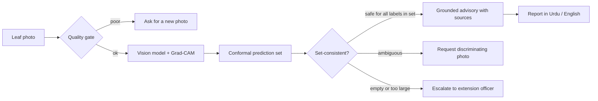

<div align="center">

# KapasGuard

**The cotton-disease agent that knows when it doesn't know.**

Region-shift-aware conformal calibration and set-consistent treatment advice for cotton disease triage in Sindh, Pakistan.


</div>

---

## Why this exists

Leaf-disease classifiers report near-perfect accuracy on controlled datasets, then
degrade sharply on real fields in a different region. When they fail, they still
return one confident label and one treatment recommendation. For a farmer, a wrong
confident answer is worse than "I am not sure, send another photo."

KapasGuard is built around one rule: **never give advice the model cannot justify.**

## Contributions

| | Contribution | What it answers |
|---|---|---|
| **C1** | **SindhCotton-Shift protocol:** leakage-safe, region- and season-held-out evaluation | How much does accuracy really drop across regions? |
| **C2** | **Calibration-budget study:** coverage and set size vs. number of local images | How many local labels restore a 90% coverage guarantee after shift? |
| **C3** | **Set-consistent advisory:** advice is issued only if safe for every disease in the prediction set | Does uncertainty-aware advice reduce unsafe recommendations? |

## How it works



**Design target (illustrative, not real output):**

```text
Input   : photo of a cotton leaf
Set     : { Disease A, Disease B }   (90% target coverage)
Decision: Single diagnosis is not certain.
Action  : Issue only advice that is safe for both labels,
          and request a photo of the leaf underside.
Source  : <document, page>
```

## Results

Results are reported only after experiments are run. Nothing below is a claim yet.

| Method | Coverage (target 90%) | Avg. set size | ECE | Advice-safety rate |
|---|---|---|---|---|
| Source-only conformal | TBD | TBD | TBD | TBD |
| Target-calibrated conformal | TBD | TBD | TBD | TBD |
| Covariate-shift-weighted conformal | TBD | TBD | TBD | TBD |
| Single-label baseline | n/a | 1 | TBD | TBD |

## Hypotheses

- **H1:** Source-only conformal under-covers on held-out Sindh data.
- **H2:** A small local calibration set restores target coverage.
- **H3:** Set-consistent advice lowers the rate of unsafe recommendations versus a single-label baseline.

## Project structure

```text
kapasguard/
├── src/kapasguard/
│   ├── data/          # loaders, dedup, leakage-safe splits
│   ├── models/        # backbones, training, Grad-CAM
│   ├── uncertainty/   # calibration, conformal, budget study
│   ├── agent/         # LangGraph workflow, tools, advisory rules
│   ├── rag/           # retrieval over verified documents
│   └── eval/          # metrics and reporting
├── notebooks/         # EDA, baseline, shift, conformal
├── configs/           # YAML experiment configs
├── tests/
├── reports/           # figures and tables
└── pyproject.toml
```

## Setup

```bash
git clone https://github.com/jotilohana21/kapasguard.git
cd kapasguard
pip install -e .
pytest
```

## Data and ethics

- Field images are collected with the farmer's consent; no personal data is stored.
- Raw data is not committed; `scripts/` documents how to obtain it.
- The disease-to-action table is reviewed by an agronomy expert before any advice is enabled.
- KapasGuard is a research prototype. It does not replace an agriculture extension officer.

## Limitations

- Public cotton datasets are small and region-limited; local data collection is ongoing.
- Urdu and Sindhi output quality of the language model is still being evaluated.
- Novelty claims are pending a full literature review.

## Roadmap

- [ ] Week 1: data audit, leakage-safe splits, baseline model
- [ ] Week 2: cross-region evaluation, conformal calibration (C1, C2)
- [ ] Week 3: set-consistent advisory agent with RAG (C3)
- [ ] Week 4: Telegram bot, evaluation report, write-up

## Related work

See [`docs/related_work.md`](docs/related_work.md).

## Author

**Joti Lohana**, Computer Science, QUEST Nawabshah, Pakistan.
[LinkedIn](https://www.linkedin.com/in/joti-lohana-6471a62a6/) · [Kaggle](https://www.kaggle.com/jotilohana) · [GitHub](https://github.com/jotilohana21)
